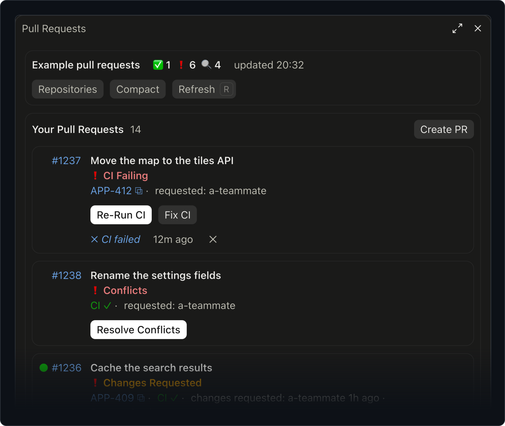
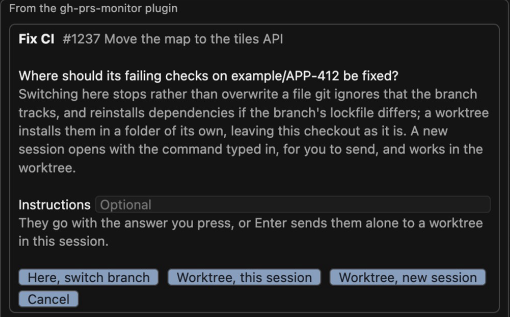
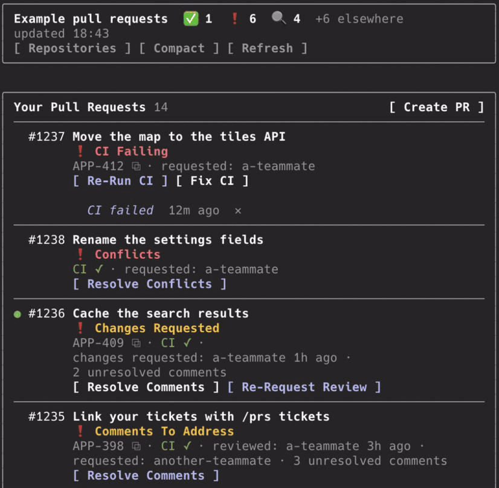
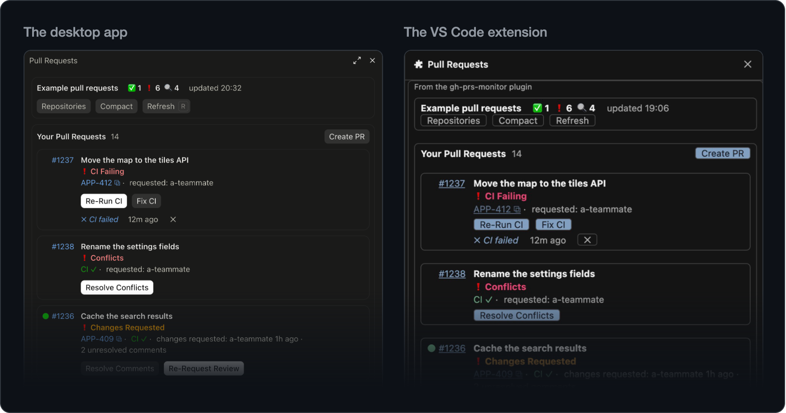

<!-- Made from gh-prs-monitor/README.md by maintenance/readme.py: edit that file, then run it. -->

<p align="center">
  
</p>

<h1 align="center">gh-prs-monitor</h1>

<p align="center">
  <strong>Your GitHub pull requests, inside Claude Code.</strong><br>
  See what needs you, know when it changes, and act on it from the list, or hand the work to a skill.
</p>

<p align="center">
  <a href="https://github.com/maturada/gh-prs-monitor/actions/workflows/ci.yml"></a>
  <a href="https://github.com/maturada/gh-prs-monitor/releases/latest"></a>
  
  <a href="LICENSE"></a>
</p>

<p align="center">
  <a href="#what-it-does">What it does</a> · <a href="#get-started">Get started</a> · <a href="#features">Features</a> · <a href="#commands">Commands</a> · <a href="#documentation">Documentation</a> ·
  <a href="https://github.com/maturada/gh-prs-monitor/issues">Issues</a>
</p>


CI failed, a review came in, a teammate asked for your review: gh-prs-monitor tells you in the session you are already
in. `/prs` opens your pull requests with what needs you on top and a button for the next step: merge, re-run CI or ask
for a review in one press, or hand the fix to a skill. Nothing is written to GitHub without your yes. Try it on example
data with `/prs demo`.

## What it does

- **See what needs you.** Your pull requests and the ones waiting on your review, what needs you on top.
- **Know when it changes.** An alert when CI fails, a review comes in or a pull request can merge, and a count in the
  status line.
- **Act in one press.** Merge, update a branch, re-run CI or ask for a review, each confirmed before it writes.
- **Hand off the work.** Skills resolve review comments, fix CI, resolve conflicts, review and open pull requests; the
  first three can work in a worktree of their own, so your checkout stays as it is.
- **Look beyond this folder.** Show another repository in the pane, and get alerts from the others if you like.
- **Link your tickets.** Paste one ticket link, and each pull request that names a ticket links it in Linear, Jira or
  whichever tracker you use: no token, no integration.
- **Light on tokens.** The pane, the checks and the alerts make no model requests; only a skill you start does.

[A day with it](gh-prs-monitor/docs/a-day-with-it.md) follows a working day with the plugin, from the first session to the next
branch.

## Get started

In Claude Code:

```
/plugin marketplace add maturada/gh-prs-monitor
/plugin install gh-prs-monitor@gh-prs-monitor
```

Choose **Install for you (user scope)** and run `/reload-plugins`. `/prs demo` shows example pull requests and sends
nothing to GitHub; `/prs`, in any folder whose git remote is on GitHub, shows your own. Esc closes the pane, and
`/config` sets when it checks and which alerts show. The pictures on this page show `/prs demo` or other made-up data.

You need the [GitHub CLI](https://cli.github.com) signed in (`gh auth login`); [Requirements](#requirements) has the
rest. gh-prs-monitor is a Claude Code plugin, installed with `/plugin`, not a `gh` extension.

## Features

### What needs you, on top

Your pull requests are sorted by what they need: failing and conflicting first, then what waits on you, then what is
ready to merge. The ones waiting on your review have a list of their own, and what someone else merged or closed lately
is noted under them. Failing checks, conflicts and unresolved comments link to where you deal with them on GitHub, and a
note under a row says what changed lately. **Compact** puts each on one line. [The pane](gh-prs-monitor/docs/pane.md)



### Alerts while you work

Alerts come while you work, with no pane to keep open: when one of yours can merge, gets a review or a comment, fails CI
or runs into conflicts; when you are asked to review, or a pull request you reviewed without approving gets new commits;
when someone mentions you, or someone else merges or closes one of yours or one you review.

- **They don't cut in.** Alerts that come while Claude works wait for the turn to end, five minutes at most, and your
  sessions share which ones they showed, so a change alerts once.
- **Coming back.** It checks in the background, every three minutes by default: a new session sums up what changed
  since you last looked, and the status line keeps the count.
- **Your way.** `/config` picks the kinds; a sound and system notifications (in the terminal) are there too, off by
  default.

[Alerts and the status line](gh-prs-monitor/docs/alerts.md)


### One press for the routine

Each row offers the button its state calls for: **Merge** (stacked pull requests too), **Auto-Merge**,
**Update Branch**, **Re-Run CI** for the failed jobs, **Ready For Review**, **Request Review** with the people GitHub
suggests, and **Re-Request Review**. Each press looks at the pull request on GitHub first, offers only what your
repository allows, and asks before it writes; a merge goes through only while the pull request's head is still the
commit you saw. [Acting on GitHub](gh-prs-monitor/docs/actions.md)

### Skills that do the work

- **Resolve Comments** sorts each unresolved comment as needs fix, debatable or already fixed, and fixes the ones you
  approve. [More](gh-prs-monitor/docs/resolve-comments.md)
- **Fix CI** reads the failing logs, tells a flaky failure from a real one, and fixes the ones you pick.
  [More](gh-prs-monitor/docs/fix-ci.md)
- **Resolve Conflicts** merges the base in apart from your checkout, reads both sides and their commit messages, and
  proposes a resolution for each conflict, for you to approve. [More](gh-prs-monitor/docs/resolve-conflicts.md)
- **Review** leaves out what other reviewers and bots already raised, checks each finding before it shows it, and
  posts only the comments you approve. On a pull request you reviewed before, it can cover only what changed since and
  tell you what came of your comments. [More](gh-prs-monitor/docs/review.md)
- **Create PR** runs the checks you pick, drafts the title and body in your repository's own format, and remembers your
  choices for next time. [More](gh-prs-monitor/docs/create-pr.md)

Resolve Comments, Fix CI and Resolve Conflicts ask where to work: in a worktree of their own, so your checkout and your
uncommitted changes stay as they are; in this checkout; or in a new session. A worktree comes ready, its dependencies
installed from the project's lockfile (JavaScript, Flutter and Dart, iOS, Python, Ruby, PHP, .NET) and your `.env` and
other ignored files copied as `.worktreeinclude` names them, and it goes once its pull request is done and nothing in it
would be lost. Review and Create PR run here or in a new session. [Where the skills work](gh-prs-monitor/docs/working-on-a-branch.md)



### Your other repositories

Check on another repository without leaving this one. Press **Repositories** in the pane's header, beside Refresh, or
type `/prs acme/web`, `/prs ~/code/web` or a pull request's address; its buttons work there too, and **Back** returns to
this folder's list. Turn on **Alerts from other repositories** in `/config` for alerts about reviews and CI in the
others, and a `+3 elsewhere` count in the header. [Other repositories](gh-prs-monitor/docs/other-repositories.md)



### Your tickets, one click away

Paste a link to any ticket with `/prs tickets`, once per repository, and each pull request whose branch or title names
its key shows it on its row, `WEB-5785 ⧉`, a click away in Linear, Jira or whichever tracker you use. There is no token
and no integration: the plugin reads that one link on your machine and never contacts your tracker itself. Create PR
puts the ticket where your repository's pull requests do, and with your tracker's tool connected to Claude Code, Review
weighs the change against what the ticket asks, for you alone. [Ticket links](gh-prs-monitor/docs/tickets.md)


### Terminal, desktop app and VS Code

The pane opens beside the conversation in the terminal, in the Claude desktop app, and in the Claude Code extension for
VS Code and editors built on it, with the count in the status line, or in a band above the prompt in the desktop app.
From your phone or claude.ai over Remote Control, `/prs` prints the list in the conversation.
[Where each part shows](gh-prs-monitor/docs/pane.md#where-each-part-shows)



### Light on tokens

The pane, the checks, the alerts and the status line make no model requests; a skill does once you start it, and the
skills stay out of the model's context until one runs. The plugin's two tools add their descriptions, a few hundred
tokens. Each check is one main GitHub request, shared by your sessions in a repository: checking every 3 minutes uses 2%
of the 5,000 points an hour GitHub gives you, for each repository. [Cost](gh-prs-monitor/docs/settings.md#cost)

## Commands

| Command | What it does |
|---|---|
| `/prs` | Opens the pane; Esc closes it. |
| `/prs demo` | Shows example pull requests, one of each status, with their alerts; nothing is sent to GitHub. |
| `/prs acme/web` | Shows another repository: `owner/name`, an address, or a clone's folder such as `~/code/web`. |
| `/prs tickets` | Sets up [ticket links](gh-prs-monitor/docs/tickets.md) for this repository. |
| `/prs report` | Links to report a bug with your versions filled in, or to suggest an idea. |
| `/prs close` | Closes the pane from the prompt. |

| Skill | What it does |
|---|---|
| `/gh-prs-monitor:resolve-comments` | Resolves a pull request's review comments. |
| `/gh-prs-monitor:fix-ci` | Fixes its failing CI. |
| `/gh-prs-monitor:resolve-conflicts` | Resolves its conflicts with its base. |
| `/gh-prs-monitor:review` | Reviews a pull request; with `since`, only what changed since your last review. |
| `/gh-prs-monitor:create-pr` | Opens a pull request from the branch checked out. |

Resolve Comments, Fix CI and Resolve Conflicts take a pull request's number or URL, or the current branch's without
one. Review needs a number or URL, and Create PR uses the branch checked out. Each takes instructions after `--`, as in
`/gh-prs-monitor:review 142 since -- focus on the migration`. The pane's buttons start the same skills, first asking
where to run.

## Requirements

- **Claude Code 2.1.292 or later**; in VS Code and editors built on it, the Claude Code extension 2.1.299 or later.
- **The [GitHub CLI](https://cli.github.com) 2.53 or later**, signed in with `gh auth login`. The plugin works through
  your account and has no token of its own.
- **git 2.31 or later.**
- **A folder whose git remote is on GitHub:** github.com, or GitHub Enterprise Server 3.16 or later.

The versions it is tested with, and what each setup needs:
[Versions and setups](gh-prs-monitor/docs/troubleshooting.md#versions-and-setups).

## Updates and removal

- **Updates:** in `/plugin`, under **Marketplaces**, select `gh-prs-monitor` and choose **Enable auto-update**, or
  **Update now** on the **Installed** tab. A new version loads in the next session, or after `/reload-plugins`.
  What each version changed: [CHANGELOG](https://github.com/maturada/gh-prs-monitor/blob/main/CHANGELOG.md).
- **From a shell:** `claude plugin marketplace add maturada/gh-prs-monitor`, then
  `claude plugin install gh-prs-monitor@gh-prs-monitor`; `claude plugin update gh-prs-monitor@gh-prs-monitor`
  updates it.
- **To remove it:** uninstall it in `/plugin`, or run `claude plugin uninstall gh-prs-monitor@gh-prs-monitor`.

## What it runs and what it sends

The plugin makes no network request of its own. It works through your own `gh` and `git`, and the dependency installs
it runs for a skill fetch from the project's package registries, as running them yourself would. It writes nothing to
GitHub without your yes and keeps what it remembers on your machine. It has no server, no token of its own and no
telemetry, and reads no credential to sign in with.

| What | How |
|---|---|
| Reading GitHub | `gh api`: one GraphQL request for the list at each check, and a few more for what a press, a cleanup or the list needs to see; with **Alerts from other repositories** on, one more at each check, searching your other repositories (once when the picker opens with it off); a repository you show, one more list while it shows. `gh repo view`, `gh auth status`, `gh config get` and `gh --version` besides. |
| Writing to GitHub | `gh pr merge`, `gh pr update-branch`, `gh pr ready`, `gh run rerun` and `gh api`, each after you confirm it. |
| git | Its own commands run with hooks off: fetching a pull request's branch with gh's credentials (`gh auth git-credential`), the skills' worktrees, switching a checkout to a pull request's branch, removing branches in cleanup, a branch's upstream in git config, and a `/.claude/worktrees/` line in `.git/info/exclude`. |
| Installs | A worktree's dependencies, and after **Here, switch branch** a changed lockfile's, with the project's own package manager: these fetch from its registries and run its install scripts. None for a fork's pull request. |
| Files | Copies the ignored files `.worktreeinclude` names into a new worktree; leaves a `.gh-prs-monitor-lock` marker where an install succeeded; removes worktrees once their pull request is done and nothing in them would be lost; reads a few files to pick an install, and the git config of your clones and of a folder you type. |
| The skills | Run in your conversation, through Claude Code's tools and your permission settings, and commit, push, reply and post only on your yes. A button that starts one runs only that skill's own slash command. |
| Claude Code | Follows session and turn events and the skills' commands, reading none of the conversation but a skill command's arguments; opens a new session through Claude Code's own links; gives the skills two tools of its own. |
| Alerts | Toasts, the status line and, if you turn them on, a sound (`afplay`, on macOS) and system notifications, all through Claude Code. The plugin's sound and images hold no code. |
| `/prs report` | Runs `uname`, on macOS `sw_vers`, `gh --version` and `git --version` for the versions it fills in. |

It keeps, in Claude Code's plugin store on your machine: the last list and what you have seen of it for the 20
repositories you looked at last, the alerts shown, the answers your sessions share and which session is asking GitHub or
cleaning up a clone right now, the view you chose, your Create PR choices and ticket links, what cleanups left, and the
folders of the 50 clones your sessions loaded a list in last, with each one's repository. For the session alone, Claude
Code's plugin state holds a repository you show and what **Alerts from other repositories** read.

Every command, file and setting it touches, in full: [What it runs and what it sends](gh-prs-monitor/docs/what-it-runs.md). More in
[Privacy](https://github.com/maturada/gh-prs-monitor/blob/main/PRIVACY.md) and
[Security](https://github.com/maturada/gh-prs-monitor/blob/main/SECURITY.md).

## Documentation

- [A day with it](gh-prs-monitor/docs/a-day-with-it.md): a working day with the plugin
- [The pane](gh-prs-monitor/docs/pane.md): the two lists, every status, the compact view, and where each part shows
- [Alerts and the status line](gh-prs-monitor/docs/alerts.md): what is alerted, and when
- [Acting on GitHub](gh-prs-monitor/docs/actions.md): the buttons, and the dialog they ask in
- [Resolve Comments](gh-prs-monitor/docs/resolve-comments.md), [Fix CI](gh-prs-monitor/docs/fix-ci.md),
  [Resolve Conflicts](gh-prs-monitor/docs/resolve-conflicts.md), and [where they work](gh-prs-monitor/docs/working-on-a-branch.md)
- [Review](gh-prs-monitor/docs/review.md) and [Create PR](gh-prs-monitor/docs/create-pr.md)
- [Other repositories](gh-prs-monitor/docs/other-repositories.md): showing another repository, and alerts from the others
- [Ticket links](gh-prs-monitor/docs/tickets.md): set up once per repository
- [Settings and cost](gh-prs-monitor/docs/settings.md)
- [What it runs and what it sends](gh-prs-monitor/docs/what-it-runs.md)
- [When something is wrong](gh-prs-monitor/docs/troubleshooting.md)
- [Development](gh-prs-monitor/docs/development.md): for contributors

## Contributing and license

Bugs and ideas are welcome in the [issues](https://github.com/maturada/gh-prs-monitor/issues); `/prs report` opens one
with your versions filled in. How changes are made:
[CONTRIBUTING.md](https://github.com/maturada/gh-prs-monitor/blob/main/CONTRIBUTING.md).

MIT licensed, see [LICENSE](gh-prs-monitor/LICENSE). Maintained by David Matura.
