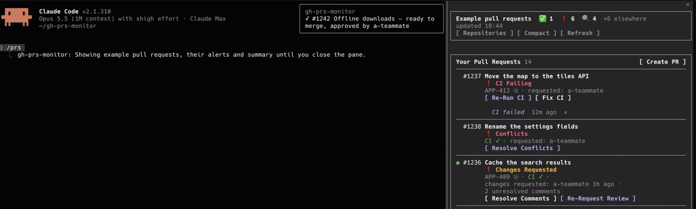
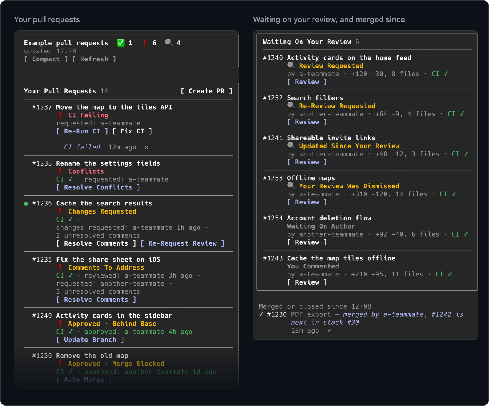
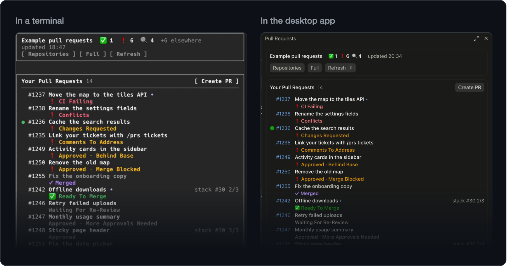
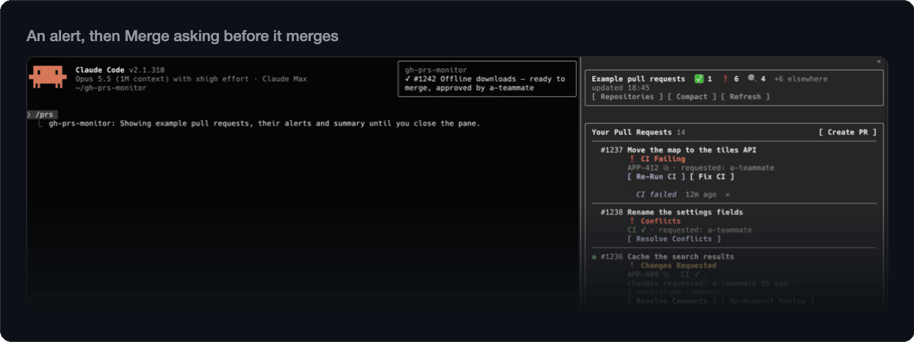
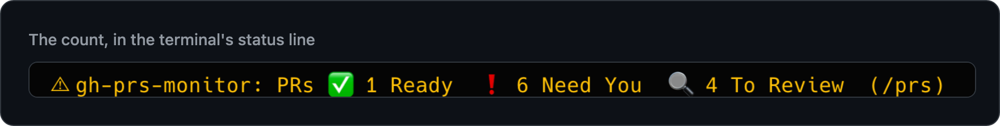
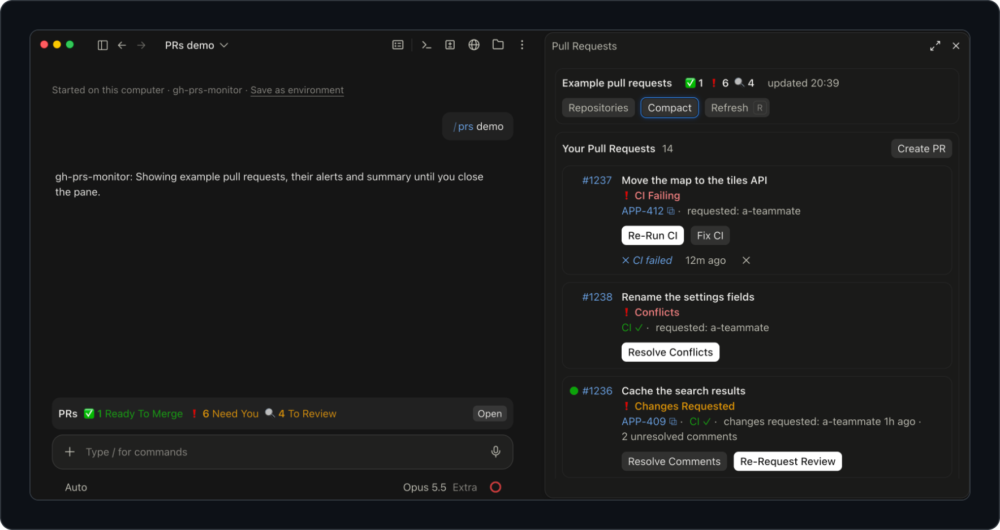
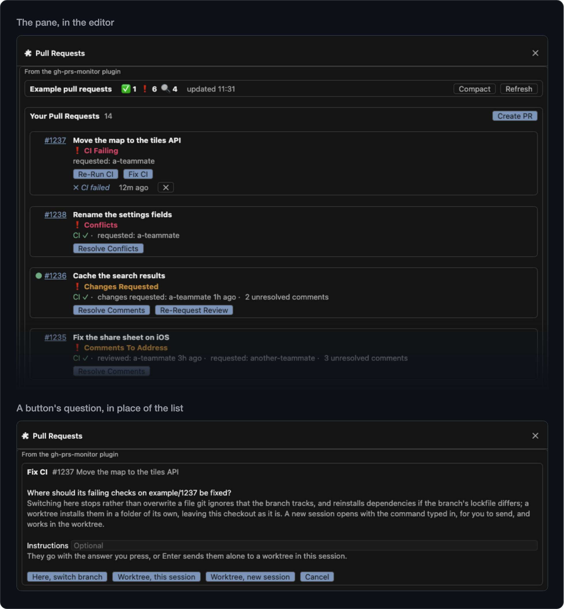

<!-- Made from gh-prs-monitor/README.md by maintenance/readme.py: edit that file, then run it. -->

<p align="center">
  
</p>

<h1 align="center">gh-prs-monitor</h1>

<p align="center">
  <strong>Your GitHub pull requests, inside Claude Code.</strong><br>
  See what needs you, know when it changes, and act on it without leaving your session.
</p>

<p align="center">
  <a href="https://github.com/maturada/gh-prs-monitor/actions/workflows/ci.yml"></a>
  <a href="https://github.com/maturada/gh-prs-monitor/releases/latest"></a>
  
  <a href="LICENSE"></a>
</p>

<p align="center">
  <a href="#what-it-does">What it does</a> · <a href="#get-started">Get started</a> · <a href="#features">Features</a> · <a href="#commands">Commands</a> · <a href="#documentation">Documentation</a> ·
  <a href="https://github.com/maturada/gh-prs-monitor/issues">Issues</a>
</p>



Stop switching to GitHub to check on your pull requests. gh-prs-monitor is a Claude Code plugin that keeps the ones you
opened, and the ones waiting on your review, right where you work: the moment CI fails, a review lands or a pull
request is ready to merge, you know. Merge it, fix it or review it from the same place, or hand the work to a skill,
and nothing reaches GitHub without your yes.

The screenshots show `/prs demo`, the plugin's example pull requests.

## What it does

- **See what needs you.** Your open pull requests and review requests in one pane, one status each, sorted so the one
  that needs you is on top.
- **Know the moment it changes.** Alerts while you work and a count in the status line, with no pane to keep open; in
  the terminal, system notifications too, if you want them.
- **Act in one press.** Merge, update a branch, re-run CI or ask for a re-review, each confirmed before it writes.
- **Hand off the work.** Skills resolve review comments, fix CI, resolve conflicts, review and create pull requests,
  and post only on your yes.
- **Never lose your place.** Skills can work in a worktree of their own, dependencies installed, so your checkout and
  your uncommitted changes stay untouched; the worktree clears itself away once nothing in it would be lost.
- **Spend tokens only on real work.** The pane, the checks, the alerts and the status line make no model requests; only
  a skill you start does.

## Get started

In Claude Code:

```
/plugin marketplace add maturada/gh-prs-monitor
/plugin install gh-prs-monitor@gh-prs-monitor
```

Choose **Install for you (user scope)** and run `/reload-plugins`. Then `/prs demo` shows example pull requests, and
`/prs`, in any folder whose git remote is on GitHub, shows your own. Esc closes the pane, and `/config` sets when it
checks and which alerts show.

You need the [GitHub CLI](https://cli.github.com) signed in (`gh auth login`); [Requirements](#requirements) has the
rest. gh-prs-monitor is a Claude Code plugin, installed with `/plugin`, not a `gh` extension.

## Features

### The pane

Your pull requests are sorted by what they need: failing and conflicting first, then what waits on you, then what is
ready to merge, then what waits on others, drafts last. The ones waiting on your review have a list of their own, and a
last part lists what was merged or closed lately. Failing checks, conflicts and unresolved comments link to the page on
GitHub where each is dealt with. A note under a row says what changed lately; `●` marks the pull request your session's
branch is on. [The pane](gh-prs-monitor/docs/pane.md)



**Compact** keeps each pull request to its number, title and status, for a long list:



**`#` in the prompt** offers the pull requests listed, yours first: type `#` and the start of a number, or of a word
in a title, and pick one to write its number. In the terminal: the desktop app and VS Code don't ask plugins for
these yet.

### Alerts and the status line

From the moment a session starts, it checks in the background every 3 minutes. An alert says when:

- one of yours can merge, is approved or gets changes requested, gets comments, fails CI or passes it again, or runs
  into conflicts;
- you are asked to review, or a pull request you reviewed without approving gets new commits;
- someone mentions you, or someone else merges or closes one of yours or one you review.

Alerts that come while Claude is working wait until the turn ends, and when a session starts, one alert sums up what
changed since you last looked. **Alerts as system notifications** (off by default) also sends the pull request
changes as a system notification, the way Claude Code sends its own. Here they arrive while the pane is open, and a
button asks before it acts:



With background refresh (the default), the terminal's status line keeps the count. [Alerts](gh-prs-monitor/docs/alerts.md)



### One press for the routine

**Merge** (stacked pull requests too, with the methods the repository allows, your usual one first), **Auto-Merge**,
**Update Branch**, **Re-Run CI** for the failed GitHub Actions jobs, **Ready For Review** and **Re-Request Review**.
Each first looks at the pull request as it stands on GitHub at the press, not as the list last read it, then asks
before it writes. [Acting on GitHub](gh-prs-monitor/docs/actions.md)

### Skills that do the work

- **Resolve Comments** sorts each unresolved comment as needs fix, debatable or already fixed, and fixes the ones you
  approve. [More](gh-prs-monitor/docs/resolve-comments.md)
- **Fix CI** reads the failing checks' logs, tells a flaky failure from a real one, and fixes the ones you pick.
  [More](gh-prs-monitor/docs/fix-ci.md)
- **Resolve Conflicts** merges the base in apart from your checkout and proposes a resolution for each conflict, for
  you to approve. [More](gh-prs-monitor/docs/resolve-conflicts.md)
- **Review** leaves out what other reviewers and bots already raised, checks each finding before it shows it, and
  posts its inline comments only after you approve their wording. [More](gh-prs-monitor/docs/review.md)
- **Create PR** runs the checks you pick, drafts the title and body in the repository's own format, and remembers
  your choices for next time. [More](gh-prs-monitor/docs/create-pr.md)

### Your checkout stays yours

Resolve Comments, Fix CI and Resolve Conflicts ask where to work: in a git worktree of their own, in this session or a
new one, where your checkout and your uncommitted changes stay as they are; or here, switching this checkout to the
pull request's branch. A worktree gets its dependencies installed from each project's lockfile (JavaScript, Flutter and
Dart, iOS, Python, Ruby, PHP and .NET), and the ignored files your `.worktreeinclude` names, such as a `.env`; a fork's
pull request gets neither. Once the pull request is merged or closed, the worktree goes, when nothing in it would be
lost. [Where the skills work](gh-prs-monitor/docs/working-on-a-branch.md)

### In the desktop app

The pane sits beside the conversation, with both lists side by side when there is room, and the count in a band above
the prompt. [Where each part shows](gh-prs-monitor/docs/pane.md#where-each-part-shows)



### In VS Code

In VS Code, and editors built on it such as Cursor, the Claude Code extension (2.1.299 or later) draws the pane, its
alerts and the count above the prompt box, and New session opens a new tab of the editor. Where nothing draws what
plugins add, as in an older extension, `/prs` prints the list instead, led by what changed since you last looked.
[Where each part shows](gh-prs-monitor/docs/pane.md#where-each-part-shows)



### Light on tokens and rate limits

The pane, the checks, the alerts and the status line make no model requests; a skill does once you start it. The skills
stay out of the model's context until one runs; the plugin's one tool, `create_pr_choices`, adds its description, a few
hundred tokens, or only its name where Claude Code defers tools. Each check is one GitHub request of 5 rate-limit
points, which your sessions in a repository share, in the terminal, VS Code and the desktop app alike: every 3 minutes,
that is 2% of the 5,000 points an hour your account gets, for each repository. [Cost](gh-prs-monitor/docs/settings.md#cost)

## Commands

| Command | What it does |
|---|---|
| `/prs` | Opens the pane. Esc closes it. Sent over Remote Control, from your phone or claude.ai, it also prints the list there. |
| `/prs demo` | Shows example pull requests, one of each status, with their alerts. Nothing is sent to GitHub. |
| `/prs close` | Closes the pane, for when a click does nothing. |
| `/prs report` | Links to report a bug, with your versions filled in, or to suggest an idea. |
| `/gh-prs-monitor:review <number or URL> [-- <instructions>]` | Reviews a pull request. |
| `/gh-prs-monitor:resolve-comments [<number or URL>] [-- <instructions>]` | Resolves its review comments. |
| `/gh-prs-monitor:fix-ci [<number or URL>] [-- <instructions>]` | Fixes its failing CI. |
| `/gh-prs-monitor:resolve-conflicts [<number or URL>] [-- <instructions>]` | Resolves its conflicts with its base. |
| `/gh-prs-monitor:create-pr [-- <instructions>]` | Opens a pull request from the branch checked out. |

Without a number or URL, the branch skills take the pull request of the current branch. The pane's buttons start the
same skills, and first ask where they should run: Resolve Comments, Fix CI and Resolve Conflicts here, in a worktree or
in a new session; Review and Create PR here or in a new session. A button's question replaces the list until you answer
it; **Cancel** (or Esc, in the terminal) leaves it.

## Requirements

- **Claude Code 2.1.292 or later**: tested on 2.1.292, 2.1.295, 2.1.296 and 2.1.299 to 2.1.304, the desktop app's
  2.1.293, and the VS Code extension's 2.1.303.
  - **Alerts as system notifications** needs 2.1.295; before it, alerts show as toasts only.
  - In VS Code and editors built on it, the pane needs the Claude Code extension 2.1.299 or later, in a session that
    [fetches feature flags](https://code.claude.com/docs/en/env-vars#features-that-need-feature-flag-fetching).
- **The [GitHub CLI](https://cli.github.com) (`gh`) 2.53 or later**, signed in with `gh auth login`. The plugin works
  through your `gh` account and has no token of its own, so it sees what you can see. **Update Branch** needs
  `gh pr update-branch`, which came with 2.53. Tested with `gh` 2.97.
- **git 2.31 or later.** The worktrees the branch skills work in, and their cleanup, use
  `git rev-parse --path-format=absolute`; **Here, switch branch** uses `git switch`.
- **A folder whose git remote is on GitHub:** github.com, or GitHub Enterprise Server 3.16 or later, the version whose
  schema the list query was checked against. Anywhere else the plugin stays quiet, and `/prs` says why. With several
  remotes, `gh` picks the repository: the one `gh repo set-default` chose, else the remote named `upstream`, `github`,
  then `origin`.

If `gh` is missing or signed out, a notice tells you once, with the fix.

## Updates and removal

- **Updates** come as new versions. To get them as they come out, open `/plugin`, go to **Marketplaces**, select
  `gh-prs-monitor` and choose **Enable auto-update**; otherwise choose **Update now** for the plugin on the
  **Installed** tab. A new version loads in the next session, or after `/reload-plugins`. What each version changed:
  [CHANGELOG](https://github.com/maturada/gh-prs-monitor/blob/main/CHANGELOG.md).
- **From a shell:** `claude plugin marketplace add maturada/gh-prs-monitor` and
  `claude plugin install gh-prs-monitor@gh-prs-monitor` install it, and
  `claude plugin update gh-prs-monitor@gh-prs-monitor` updates it.
- **To remove it**, uninstall it in `/plugin`, or run `claude plugin uninstall gh-prs-monitor@gh-prs-monitor`.

## What it runs and what it sends

In short: the plugin makes no network request of its own. It works through your own `gh` and `git`, writes nothing to
GitHub without your yes, and keeps what it remembers on your machine; the dependency installs it runs for a skill fetch
from the project's package registries, as running them yourself would. The rest of this section says exactly what it
runs and touches.

It has no server, no token of its own and no telemetry, and reads no credential to sign in with: besides your `gh` and
`git`, it uses Claude Code's own links.

- **GitHub, through `gh`.** It reads with `gh api`: one GraphQL request for the list at each check, and a few more for
  how pull requests that left the list ended, for the pull requests of your branch, and for what a press or a cleanup
  needs to see; `gh repo view`, `gh config get git_protocol` and `gh --version` besides. It writes with `gh pr merge`,
  `gh pr update-branch`, `gh pr ready`, `gh run rerun` and `gh api`, each only after you confirm it in its dialog. How
  many requests that comes to: [Cost](gh-prs-monitor/docs/settings.md#cost).
- **git.** Every git command the plugin runs itself carries `core.hooksPath=/dev/null`, so no hook a repository carries
  runs from it. A pull request's branch is fetched with gh's credentials (`gh auth git-credential`) in place of your own
  credential helper, as `gh pr checkout` fetches it. The skills' commits and pushes do run the repository's hooks; on
  someone else's pull request, the skill names them in its preview and runs them only on your yes.
- **Installs.** In a worktree it makes for a skill, and after **Here, switch branch** for each project whose lockfile
  changed, it installs the dependencies with the project's own package manager, from its lockfile: `npm ci`, `pnpm`,
  `yarn`, `bun`, `flutter pub get` or `dart pub get`, `uv sync`, `poetry`, `pipenv sync`, `bundle`, `composer`,
  `dotnet restore` or `pod install`, on Windows tried once more through `cmd`. These fetch from the project's package
  registries and run its install scripts, as running the install yourself would. A fork's pull request gets none.
- **Files.**
  - A new worktree gets the ignored files the repository's `.worktreeinclude` names, copied from your checkout
    (`mkdir` and `cp`, or `robocopy` on Windows); a fork's pull request gets none.
  - An install in a worktree that succeeds leaves a `.gh-prs-monitor-lock` marker in the folder it filled, such as
    `node_modules`, where git ignores it, and empties it before installing again, so the next one is skipped while the
    lockfile and the command stay the same.
  - With cleanup on, once a pull request is merged or closed, the worktrees made for it and the branches they hold
    go, and so do `pr-<number>` branches that still track it, when nothing in them would be lost
    (`git worktree remove`, `git branch -D`). A new worktree whose checkout fails goes at once, and git's entry for one
    whose folder you deleted goes when that pull request's worktree is next needed.
  - The plugin also reads `pubspec.yaml`, `yarn.lock` and `.yarnrc.yml` to pick an install; an Android
    `local.properties` in a worktree before removing it, to tell one the tools wrote from one holding keys of yours;
    its own `plugin.json` for `/prs report`; and in VS Code the editor's `product.json` for the scheme of its links
    (**New session**, below). None of what it reads is sent anywhere, besides the version and repository
    `/prs report` prints.
- **Settings.** The only settings the plugin changes are git's: a `/.claude/worktrees/` line goes in the clone's
  `.git/info/exclude` when nothing ignores that folder yet, and a pull request's branch it checks out, here or in a
  worktree, gets its upstream in the clone's git config where it has none, as `gh pr checkout` sets it. A branch that
  cleanup removes takes its settings with it.
- **The skills** (Resolve Comments, Fix CI, Resolve Conflicts, Review and Create PR) work in your Claude Code
  conversation. What they read from GitHub, the diff, the comments, the CI logs, becomes part of it like anything else
  you show Claude. They commit, push, reply and post only on your yes. Where no pane shows, the list `/prs` prints goes
  into the conversation too, as does what `/prs report` prints.
- **Slash commands.** A button that starts a skill in this session runs that skill's own command, as typing it would, at
  once or once the turn under way ends: `/gh-prs-monitor:resolve-comments`, `/gh-prs-monitor:fix-ci`,
  `/gh-prs-monitor:resolve-conflicts`, `/gh-prs-monitor:review` or `/gh-prs-monitor:create-pr`. It runs no other
  command.
- **Claude Code's events.** The plugin follows these, passes each on unchanged, and reads none of the conversation,
  only a skill command's arguments, which name its pull request:
  - a session starting, and an app attaching to it: to start its checks, and to open the pane a `/prs` asked for in
    the last ten minutes with no app to show it;
  - a session ending in a `/clear` or a resume, and the `SessionStart` that follows: to load the list for the new
    conversation;
  - each turn's start and end, by the turn's id and whether a subagent runs it: to hold alerts back while one runs, to
    let a branch switch waiting for it go on, and to see a skill's turn end. For half an hour after a skill starts, a
    turn's end can start a check of the list, at most every half minute; nothing of the turn goes into it;
  - the skills' commands above: to mark the row a skill works on.

  Besides, it answers `/prs`, printing the list too where it came over Remote Control; answers its own tool; offers pull
  requests for a word in the prompt that starts with `#`, reading that word alone; draws its pane and, in the desktop
  app, the band above the prompt; follows the pane's scrolling and focus; and keeps the pane open when you close it
  while it asks a question, cancelling the question instead.
- **New session** opens a Claude Code session through Claude Code's own link, with `open`, `xdg-open` or `rundll32`
  (after `uname`, and `reg query` on Windows, tell which). In VS Code it is the extension's link, in the scheme the
  editor answers on (`vscode`, `cursor`, …): the editor's folder comes from `VSCODE_NLS_CONFIG`, the one environment
  variable the plugin reads, and the scheme from that folder's `product.json`, else VS Code's is tried; where the link
  doesn't open, the skill runs in this session.
- **`/prs report`** runs `uname -sr`, on macOS `sw_vers`, `gh --version` and `git --version` for the versions it fills
  in.
- **Sound and images.** The plugin's `sounds/alert.wav` is the alert sound: with **Alert sound** on (it is off by
  default), Claude Code plays it with `afplay` on macOS, and elsewhere plays nothing. Its `assets/` folder holds this
  page's images and the icon `plugin.json` names for the plugin's listing. Neither holds code.
- **System notifications.** With **Alerts as system notifications** on (it is off by default), the alerts about pull
  request changes also go to Claude Code's own notification channel, one notification each time they show: the first
  alert's line and how many came with it, under the repository's name. Claude Code passes it to your `Notification`
  hooks and writes it to your terminal as its own notifications go; the plugin sends it nowhere else.
- **A tool for Create PR.** Each session gets one tool, `create_pr_choices`, which the Create PR skill calls to read and
  keep your choices for a repository, in the plugin's store; it reads or writes nothing else.
- **What it keeps**, in Claude Code's plugin store on this machine, never in a repository: the last list for each
  repository, what you have seen of it, the alerts shown, the answers your sessions share, the compact view, what
  cleanups found in each clone, and Create PR's choices.

More in [Privacy](https://github.com/maturada/gh-prs-monitor/blob/main/PRIVACY.md) and
[Security](https://github.com/maturada/gh-prs-monitor/blob/main/SECURITY.md).

## Documentation

- [A day with it](gh-prs-monitor/docs/a-day-with-it.md): a working day with the plugin, from the first session to the cleanup
- [The pane](gh-prs-monitor/docs/pane.md): the two lists, every status, the compact view, and where each part shows
- [Alerts and the status line](gh-prs-monitor/docs/alerts.md): what is alerted, when, and the summary
- [Acting on GitHub](gh-prs-monitor/docs/actions.md): the buttons, and the dialog they ask in
- [Resolve Comments](gh-prs-monitor/docs/resolve-comments.md), [Fix CI](gh-prs-monitor/docs/fix-ci.md),
  [Resolve Conflicts](gh-prs-monitor/docs/resolve-conflicts.md), and [where they work](gh-prs-monitor/docs/working-on-a-branch.md): this folder, a
  worktree or a new session; branches, dependencies and cleanup
- [Review](gh-prs-monitor/docs/review.md)
- [Create PR](gh-prs-monitor/docs/create-pr.md): when it shows, what the skill does, and what it remembers
- [Settings and cost](gh-prs-monitor/docs/settings.md)
- [When something is wrong](gh-prs-monitor/docs/troubleshooting.md)
- [Development](gh-prs-monitor/docs/development.md): the checks, the file map, and what the code relies on in Claude Code

## Contributing and license

Bugs and ideas are welcome in the [issues](https://github.com/maturada/gh-prs-monitor/issues); `/prs report` opens one
with your versions filled in. How changes are made:
[CONTRIBUTING.md](https://github.com/maturada/gh-prs-monitor/blob/main/CONTRIBUTING.md).

MIT licensed, see [LICENSE](gh-prs-monitor/LICENSE). Maintained by David Matura.
