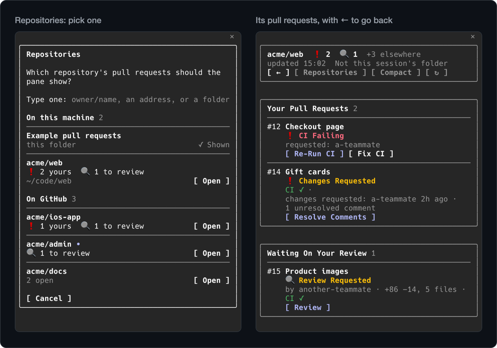

# Other repositories

Your pull requests rarely live in one repository. The pane can show another repository's pull requests beside your
conversation, and an optional light check tells you about reviews and CI in all of them, while this folder's list goes
on as it was.



## Showing another repository

Press **Repositories** in the pane's header and pick one ([the picker](#the-repository-picker)), or type it after
`/prs`:

| You type | The pane shows |
|---|---|
| `/prs acme/web` | that repository, on this folder's GitHub server |
| `/prs https://github.com/acme/web/pull/12` | the repository of a pull request's or a repository's address, on any GitHub server `gh` is signed in to |
| `/prs ~/code/web` or `/prs ../web` | the repository a session in that folder would list, read from its git config |

A folder's path finds its repository as `gh` does: the remote `gh repo set-default` chose, else `upstream`, `github`,
then `origin`, the first of them on a server the GitHub CLI is signed in to. An SSH alias, as
`git@github-work:acme/web.git`, names no server, so it counts as this folder's; one with a dot, as `github.com-work`,
reads as a server: type `owner/name` for such a clone, which the picker also offers once a session there has loaded its
list. A worktree, or a folder inside a clone, works too. A remote set in a file the config includes, or rewritten by
`insteadOf`, isn't followed: type `owner/name` for such a clone. `~` alone, or before a slash, is your home folder, and
a relative path starts at the session's folder; on Windows, `C:\code\web` and backslashes work too.

Showing one is a visit. Its header shows the repository's name and counts, a dim "Not this session's folder", and
**← acme/app** (Back), or **←** alone where that doesn't fit. **←**, or `/prs` with this folder's own repository,
shows this folder's list again. Where a problem leaves no list to show, as when the folder has no GitHub repository,
the problem box offers **Show Another Repository**.

### What a visit has, and what stays this folder's

- A visit has no branch marked, no **Create PR** and no notes of what changed, and its list raises no alerts. With
  [Alerts from other repositories](#alerts-from-other-repositories) on, its reviews and CI still alert, as any other
  repository's do.
- A pull request you merge there shows as merged in its list, and its rows show the [ticket links](tickets.md) set up
  for that repository.
- The status line and the desktop app's band go on counting this folder's list; pressing the band shows it.

### How long a visit lasts

- While the pane is open. Closing it ends the visit, and `/prs` then opens this folder's list. While a visit shows,
  `/prs` alone brings the pane forward with it still shown. `/prs demo`, `/clear` and resuming the session end it too.
- Its list is read again at each check interval while it shows, as the **Refresh** setting says
  ([Settings](settings.md)), and not while the pane is a tab behind another. Each read is one more request
  ([cost](settings.md#cost)).
- Where no pane shows, as over Remote Control from the phone or with nothing attached, `/prs acme/web` prints that list
  once as text and keeps no visit. Unlike `/prs` alone, it leaves the computer's pane as it is.

## The repository picker

The picker asks "Which repository's pull requests should the pane show?" and lists each repository as a row, grouped
as the pane groups pull requests:

- **On this machine**: this folder's repository, marked "this folder", then the clones where a session loaded its list,
  with their path (`~` is the home folder);
- **On GitHub**: repositories with no clone here where you have a pull request open or a review asked of you, as the
  [light check](#alerts-from-other-repositories) last found them (your 30 latest, and the 30 latest asking your
  review).

Each row shows what waits for you there, as `❗ 2 yours  🔍 1 to review`, or, where nothing does, how many are open
there, dim (`2 open`); and a dot after the name when one of its pull requests changed since you last opened the picker
(from its second opening on). Within the clones, and within those on GitHub, what waits comes first. Where the
repositories are on more than one GitHub server, each name starts with its server. In the **Compact** view, each row is
a line: the name, the counts in short (`🔍 1`) and **Open**.

**Open** on a row shows that repository; the one showing now reads **✓ Shown**. Typing in the field above the rows
narrows them (`web` finds `acme/web`). Enter opens the repository whose full name you typed. Otherwise it opens the
first row left, the one showing only where no other is left. With no row left, it looks up what you typed as `/prs`
does: `owner/name`, an address or a folder's path. One not listed whose name a listed one holds (`acme/a` beside `acme/app`) shows by its address or `/prs acme/a`.
What keeps a repository from showing, as a name mistyped or one you have no access to, is said in the picker, which
stays open. **Cancel** leaves the pane as it was.

Where the pane can't show the picker, as when it closed since the press, Claude Code's own dialog asks instead: four
repositories at most, the rest typed under **Other**. What you pick there opens the pane again, and what keeps it from
showing comes as a toast.

**Which clones it knows.** Each session notes its clone's folder when it first loads its list (a worktree counts as its
clone), the 50 latest. The picker offers one for each repository, the latest loaded, while its git config still names
that repository, or the old name it had there when GitHub renamed or moved it; another checkout of this folder's own
repository counts as this folder. The picker knows a clone once a session there has loaded its list; until then, type
its path or `owner/name`.

**What it costs.** Opening the picker runs the light check once (1 point of the 5,000 an hour GitHub gives you), so it
lists what waits now. With Alerts from other repositories on, what that check finds is alerted as any check's is; with
it off, it alerts nothing, and what it read is kept, while the plugin stays loaded, only to mark what changed the next
time.

## Buttons on its rows

**Merge**, **Auto-Merge**, **Update Branch**, **Ready For Review**, **Request Review**, **Re-Request Review**,
**Re-Run CI** and **Review** work as they do on this folder's list ([Acting on GitHub](actions.md)).

**Resolve Comments**, **Fix CI** and **Resolve Conflicts** work in a clone of that repository, never in this session's
folder. So instead of asking where to work, the question says so, and what to do:

- **In the terminal and the desktop app**, with a clone known, **New Session in ~/code/web** opens a new session there
  with `/prs acme/web` typed in, for you to send. The desktop app types it with a space after its `/`: delete that
  before sending, as for [Review](review.md). That session shows the repository's own list; press the same button on
  the same pull request there, and it asks where to work [as usual](working-on-a-branch.md).
- **In VS Code**, which can't open another folder from a link, the question names the folder to open in a new window
  and the steps there. The question does the same where the pane is drawn somewhere that can't open a new session.
- **With no clone known**, it says to clone the repository if you haven't (`gh repo clone acme/web` makes one) and to
  open a Claude Code session in the clone once; the clone is offered from then on.

## Alerts from other repositories

Alerts cover this folder's repository. To hear about the others too, turn on **Alerts from other repositories** in
`/config`; it is off by default. A light check then looks at your open pull requests, and those asking your review, in
every other repository on this folder's GitHub server.

### What it alerts

- a review asked of you;
- on your own pull requests, each review given, and CI failing or passing.

Conflicts, comments, merges and the other kinds need more than the light check reads, so they alert only for this
folder's repository. The kinds follow [Change alerts](settings.md#alerts), the switch for all alerts, and the
**Alert: review requests**, **Alert: reviews** and **Alert: CI** rows. An alert names its repository and ends with how
to show it:

```
✓ acme/web#12 Checkout page — approved by ann · /prs acme/web
```

The first check of a session, the first after nothing showed the session, or the first after the setting is turned on,
gives one toast of what waits and where, in place of an alert per change: `2 waiting in other repositories: acme/admin,
acme/web`. It shows only while **Alert: review requests**, **Alert: reviews** or **Alert: CI** is on, and as a toast
alone. The alerts after it go out as system notifications too where those are on, one for each repository.

### `+3 elsewhere` in the header

The pane's header counts what waits for you in your other repositories, leaving out this folder's and the one shown: a
review asked of you, and on your own pull requests CI failing, changes requested, or an approval with the checks done.
It counts them whatever alert kinds are on. A check that fails says nothing, and the count stays as the last one that
worked read it.

### When it runs, and what it costs

One GraphQL request with two searches, 1 point of the 5,000 an hour GitHub gives you ([cost](settings.md#cost)). It
follows **Refresh**: **background** checks at each interval; **while-open** at each interval while the pane is open;
**on-demand** on no timer. In every mode it checks too as the pane opens (`/prs`, the band), at ↻, and as the picker
opens, so `+N elsewhere` and the picker show what waits now. In on-demand mode too, what it finds comes as toasts, as
no list in the pane shows it.

It leaves out archived repositories, this folder's own, and, with **Hide my drafts** on, your own drafts. In a folder
with no GitHub repository, it checks the server `gh` uses by default, where `gh` is signed in to it.

### Its limits

Each search reads the 30 pull requests updated last: with more open than that, the rest alert nothing until they are
updated again. One that drops out of a full search is kept in the session for a day, 200 at most, so it isn't told
again when it comes back. Turning the setting off forgets what it read.
