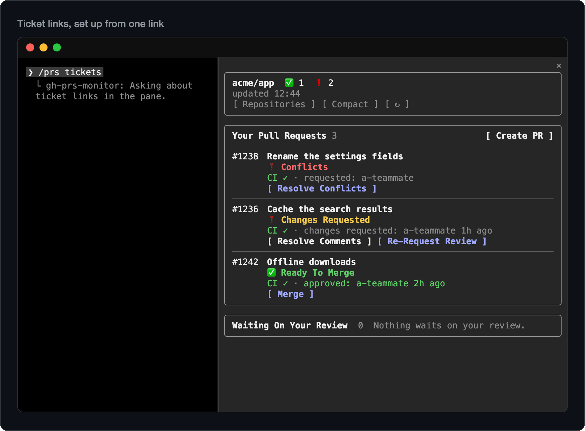

# Ticket links

**Ticket links** put each pull request's ticket one click away. Set them up once in a repository by pasting a link to
any ticket, and every pull request whose branch or title names its key shows it on its row, as `WEB-5785 ⧉`, linked to
the ticket in Linear, Jira or whichever tracker you use.

There is no token to create and no integration to connect: the plugin's own code reads that one link on your machine.
[Create PR](create-pr.md) writes the ticket where your repository writes one, and [Review](review.md) can weigh the
change against what the ticket asks. It is opt-in: until you set it up, no ticket shows on a row, and Create PR offers
to set it up once, where a branch names something like a key.

## Set them up

Run `/prs tickets` in the repository. The pane asks for a link to any ticket from your tracker, as copied from the
browser's address bar. **Check the link** (or Enter) shows what the plugin makes of it, as
`Tickets like WEB-5785 link to https://linear.app/acme/issue/WEB-5785`, and which pull request in your list it would
link; **Save** keeps it.

The link is read on your machine, by the plugin's code: nothing is sent anywhere while you set it up, and the plugin
never opens a ticket ([what it runs and sends](what-it-runs.md)).

What it reads from the link:

- **A key in the address**, as Linear, Jira, YouTrack, ClickUp's custom task IDs and most trackers write one:
  `https://linear.app/acme/issue/WEB-5785/fix-chat-scroll` makes every `WEB-` ticket link to
  `https://linear.app/acme/issue/<key>`.
- **A Jira Cloud board's link** with the ticket open on it (`…atlassian.net/…?selectedIssue=WEB-123`): its own page,
  `/browse/WEB-123`. Another tracker's board names its ticket only in its query: open the ticket on its own page and
  paste that.
- **A number alone**, as Shortcut and Azure Boards write theirs: those two are known (`sc-123`, `AB#123`). For another
  tracker, it asks how branches and titles write a ticket there, as `ENG-12`.
- **GitHub's own issues** need none of this: GitHub links `#12` by itself.
- **A link with neither a key nor a number**, as a board, a search or a list: the pane says why it can't use it. Open
  a ticket on its own page and paste that.

A second tracker, or another prefix of the same one: run `/prs tickets` again and choose **Add a link**.

## How a pull request finds its ticket

By the first key with a saved prefix in its branch, then in its title, in upper or lower case, at the start of a word:
`feature/WEB-5785-menu`, `david/web-5785-fix-login`, `[WEB-5785] Fix the menu`, and Shortcut's `sc-123` and Azure
Boards' `AB#123` alike. The key shows as you saved it (`WEB-5785` for `web-5785`). Only the prefixes you saved match,
so `UTF-8` or `node-20` in a branch is nobody's ticket.

## Where it shows

- **On its row**, the first of its details in the full view: `WEB-5785 ⧉ · CI ✓ · requested: ann`. The ⧉ says it opens
  outside GitHub. The compact view stays as it is, and a pull request without a ticket shows nothing new.
- **In the list `/prs` prints** where no pane shows, first in its details.
- **Ticket links on rows**, in `/config` (on by default), takes the link off the rows everywhere; the skills still use
  the links.

Ticket links are kept per repository in the plugin's store (where it keeps what it remembers) on this machine, so your
sessions in the terminal, the desktop app and VS Code all use them, and none of it goes into the repository.

## In the skills

- **Create PR** puts the key in the title only where your repository's titles carry one, in the commit message only
  where its commits do, and `Ticket: WEB-5785` with its link in the body. Where the repository isn't private, it writes
  the key alone unless you reply `add the link`. In a repository without ticket links, a branch that names something
  like a key (`feature/WEB-5785-…`) gets one line in the preview, once: paste a link there to set them up, or skip. A
  skip, any no, or a plain yes turns the question off for that repository. Pasted there, the link goes through your
  conversation, as anything you type does, and is kept only once you press **Save** in Claude Code's dialog, which shows
  what it would link and any address it would replace (a no holds for the rest of the session); one whose address holds
  a number alone is left to `/prs tickets`, which asks how its keys are written. [Create PR](create-pr.md)
- **Review** names the ticket in its overview. With a tool for your tracker already connected to Claude Code (Linear's
  or Atlassian's, say), it reads the ticket once, read-only, and tells you, for you alone, where the change seems to
  miss or go beyond it, as up to three questions. [Review](review.md)

The skills are told to keep what a ticket says out of everything they post to GitHub (titles, bodies, commits,
comments, replies): its key and link at most, and you see each post before it goes. Nor do they write the words that
close a ticket at merge, as `Closes WEB-5785`, unless you ask for them.

## Change or turn them off

`/prs tickets` in a repository with ticket links shows them and what they find in your list now, with **Add a link**,
**Remove** and **Done**. Removing the last one leaves them off: Create PR won't ask about tickets there again, and
`/prs tickets` sets them up again whenever you like. To keep the links for the skills but off the rows, turn **Ticket
links on rows** off in `/config`.

Where no pane shows, as from your phone over Remote Control, `/prs tickets` prints what is set up. Setting them up
waits for the terminal, the desktop app or VS Code, which have a field to paste in.
